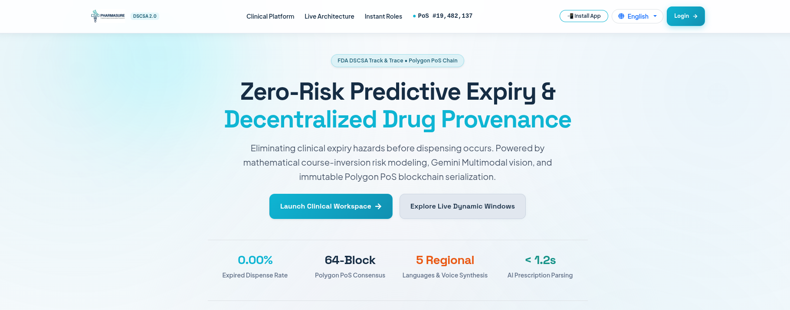
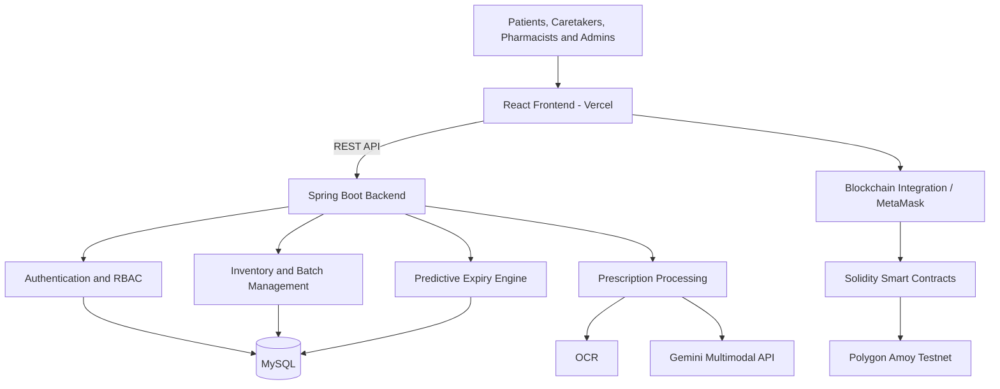
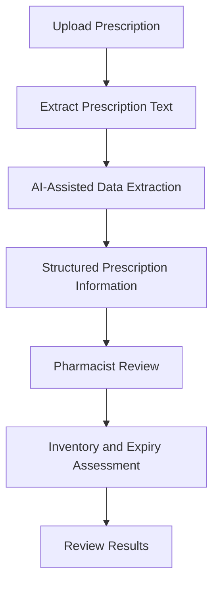
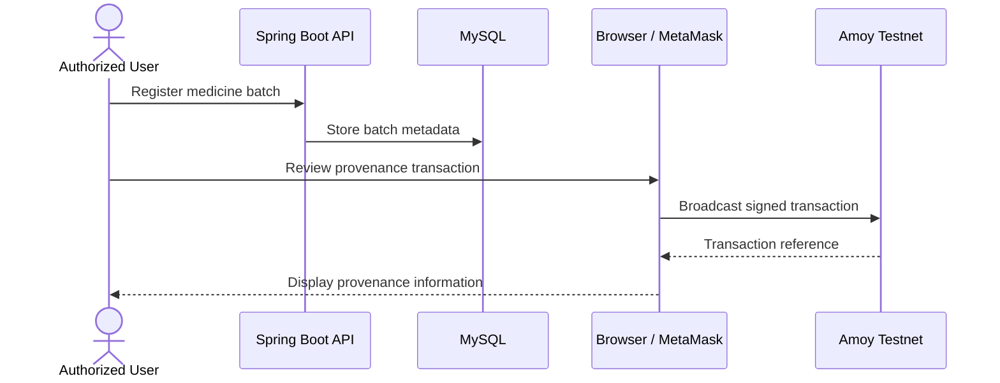
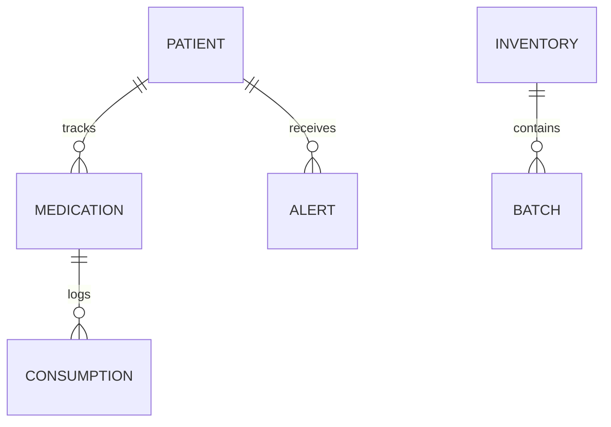

<div align="center">


# 💊 Pharmasure

### AI-Assisted Medication Management & Predictive Expiry Monitoring

[](https://github.com/9harshithp/Pharmasure/actions/workflows/ci.yml)
[](https://pharmasure.vercel.app/)
[](https://github.com/9harshithp/Pharmasure)
[](#tech-stack)
[](#tech-stack)
[](#tech-stack)
[](#tech-stack)

</div>

---

## 🖥️ Application Showcase

<div align="center">

[](https://pharmasure.vercel.app/)

*Pharmasure — AI-assisted medication management, predictive expiry monitoring and batch provenance. On-screen metrics are demonstration values, not verified clinical outcomes.*

[](https://pharmasure.vercel.app/)

</div>

---

## 📌 Project Overview

**Live website:** [pharmasure.vercel.app](https://pharmasure.vercel.app/)


Pharmasure is a healthcare-focused medication management system designed to help patients track their medicines, monitor expiry dates, manage medication information, and receive alerts for medicines approaching expiry.

The project combines a **React frontend** with a **Spring Boot backend**, **MySQL**, OCR/AI capabilities, and Gemini-powered assistance.

---

## 🚀 Features

* 👤 Patient registration and login
* 🔐 Role-based access for:

  * Patient
  * Caretaker
  * Pharmasure/Admin
* 💊 Medication management
* 📅 Medication expiry-date tracking
* 🛡️ **Predictive Expiry & Runout Engine** (computes daily dosage vs. days supply, flags courses that overrun batch expiry dates before consumption)
* 🔔 Expiry and patient alerts
* 📦 Inventory management
* 📊 Medication consumption tracking and analytics
* 🤖 Gemini-powered medication assistance
* 📷 OCR-based medication information extraction
* 📧 Email notifications
* 👨‍⚕️ Doctor and caretaker information management
* 📈 Patient dashboard and medication analytics

---

## System Architecture

Pharmasure combines pharmaceutical inventory management,
predictive expiry analysis, AI-assisted prescription processing
and blockchain-based batch provenance.



### Prescription Processing Workflow



### Drug Batch Provenance



### Engineering Design

| Design decision | Purpose |
|---|---|
| Spring Boot REST API | Modular backend services |
| MySQL | Relational inventory management |
| Predictive expiry analysis | Identify expiry-related inventory risks |
| Gemini multimodal integration | Assist prescription interpretation |
| Pharmacist review | Validate extracted information |
| Solidity smart contracts | Record batch provenance |
| Polygon Amoy Testnet | Test-network blockchain transaction processing |
| GitHub Actions | Automated build and test verification |
| Multilingual interface | Improve accessibility |

Pharmasure is an academic healthcare software prototype.
Clinical decisions require qualified professional review.

## 🗄️ Conceptual Data Model



This is a conceptual representation, not a verified physical database schema.

---

## 🛠️ Tech Stack

<div align="center">


</div>

### Frontend

* React
* JavaScript
* React Router
* Axios
* Bootstrap
* Chart.js / Recharts
* Tesseract.js
* Google Gemini API

### Backend

* Java
* Spring Boot
* Spring Data JPA
* Hibernate
* REST APIs
* Maven

### Database

* MySQL 8

### AI / OCR

* Google Gemini
* Tesseract OCR

---

## 📁 Project Structure

```text
Pharmasure/
│
├── backend/
│   ├── src/
│   │   ├── main/
│   │   │   ├── java/com/Blister/
│   │   │   │   ├── Controller/
│   │   │   │   ├── Entity/
│   │   │   │   ├── Repository/
│   │   │   │   ├── Service/
│   │   │   │   └── config/
│   │   │   └── resources/
│   │   │       ├── application.properties
│   │   │       └── application-example.properties
│   │   └── test/
│   ├── pom.xml
│   └── mvnw
│
├── frontend/
│   ├── public/
│   ├── src/
│   │   ├── Components/
│   │   ├── Assets/
│   │   ├── App.js
│   │   └── index.js
│   ├── package.json
│   └── .env.example
│
├── .gitignore
└── README.md
```

---

## ⚙️ Local Setup

### 1. Clone the repository

```bash
git clone https://github.com/9harshithp/Pharmasure.git
cd Pharmasure
```

### 2. Backend setup

Make sure the following are installed:

* Java 21
* Maven
* MySQL 8

Create the database:

```sql
CREATE DATABASE blister;
```

Create a local MySQL user if required:

```sql
CREATE USER 'pharmasure'@'localhost'
IDENTIFIED BY 'your_local_password';

GRANT ALL PRIVILEGES ON blister.*
TO 'pharmasure'@'localhost';

FLUSH PRIVILEGES;
```

### 3. Backend environment variables

Configure the following environment variables:

```text
DB_USERNAME
DB_PASSWORD
MAIL_USERNAME
MAIL_PASSWORD
GEMINI_API_KEY
```

Use:

```text
backend/src/main/resources/application-example.properties
```

as the configuration reference.

Never commit real API keys, passwords, or email credentials.

### 4. Start the backend

From the `backend` directory:

```bash
cd backend
mvn spring-boot:run
```

The backend runs by default on:

```text
http://localhost:8080
```

---

## 🌐 Frontend Setup

From the project root:

```bash
cd frontend
npm install
```

The legacy frontend configuration references the following variable for local development. React build-time variables are visible to browser users; do not put private API keys in a deployed frontend. Prefer the backend Gemini endpoint:

```env
REACT_APP_GEMINI_API_KEY=your_gemini_api_key_here
```

Then start the frontend:

```bash
npm start
```

The frontend runs by default on:

```text
http://localhost:3000
```

---

## 👥 Application Roles

| Role | Dashboard and capabilities |
|---|---|
| Patient | Medication schedules, dosage logs, adherence and expiry tracking |
| Caretaker | Associated patient monitoring and alerts |
| Pharmacist / Admin | Inventory, expiry distribution charts and reports |

For local demonstrations, configure dedicated test accounts using the project's development setup. Do not reuse personal or production credentials.

---

## 🔑 API Overview

### Patient

```text
POST /register
POST /login
GET  /getById/{id}
PUT  /update/{id}
PUT  /setAlert/{id}
PUT  /clearAlert/{id}
```

### Medication

```text
POST   /medications/add/{patientId}
GET    /medications/get/patient/{patientId}
PUT    /medications/update/{mid}
DELETE /medications/delete/{mid}
```

### Inventory & Dispensing

```text
POST /inventory
GET  /inventory
PUT  /inventory/{id}
```

### Consumption & Quick-Dose Logging

```text
POST /consumed/add/{mid}           # ⚡ 1-Tap dose logging: decrements stock & increments consumed count
GET  /consumed/check/{email}
GET  /consumed/bypatient/{p_id}
```

### Gemini Medication Assistant

```text
POST /api/gemini/medication/ask
```

---

## 🚀 Advanced Enterprise & Modern Tech Features

Pharmasure explores the following AI-assisted and inventory management capabilities. These are software prototypes and decision-support features, not clinically validated medical recommendations.

### 1. 🤖 Multimodal AI OCR Engine (`ocrScanner.js`)
* **Primary Engine:** Google Gemini (`Gemini model configured in the application`) via `@google/genai` analyzes blister packaging directly, identifying medication brand, strength, and embossed expiry stamps.
* **On-Device Fallback:** Integrated `tesseract.js` for offline OCR.
* **Regulatory Expiry Alignment:** Automatically translates pharmaceutical month-only blister text (e.g., `EXP. JUL. 29`) to a month-end date for tracking purposes (`2029-07-31`).

### 2. 🛡️ Predictive Expiry Calculator (`predictiveRiskCalculator.js`)
* **Predictive Runout Modeling:** Evaluates daily dosing patterns (`timing.length`) against current stock (`tabletQty`) to estimate the projected runout date (`runoutDate = today + daysSupply`).
* **Predictive Inversion Detection:** Flags prescriptions where `runoutDate > expiryDate` (i.e., the estimated supply extends past the entered expiry date) with an alert and buffer countdown for professional review.
* **Global Alert Banner:** Real-time alert on the Patient Dashboard alerting patients when course completion overruns batch validity.

### 3. 🔬 AI Clinical Regimen & Drug-Drug Interaction (DDI) Checker (`clinicalSafetyChecker.js`)
* Analyzes the patient's full active medication list against the configured Gemini model (with rule-based clinical fallback).
* Produces an experimental review score and possible interaction flags for professional verification; it does not establish clinical safety.

### 4. 📄 Doctor's Clinical Summary PDF Generator (`clinicalReportGenerator.js`)
* One-click export for clinical appointments.
* Compiles patient vitals, adherence rate, prescribed regimens, daily intake schedules, and predictive expiry buffers into a professional medical document.

### 5. ⚡ 1-Tap Quick-Dose Intake FAB (`QuickDoseFAB.jsx`)
* Floating Action Button enabling patients to log doses in 1 tap.
* Immediately executes `POST /consumed/add/{mid}`, decrements remaining pill count in the database, and syncs live with the adherence charts.

### 6. 🔊 Web Speech API Voice Assistant (`voiceAssistant.js`)
* Hands-free audio readouts for elderly or visually impaired patients.
* Pronounces medication schedules, dosage timings, remaining counts, and vocalizes predictive hazard warnings.

### 7. 💊 Pharmacist FEFO Engine & Smart Dispense Assistant (`Inventory.js`)
* **FEFO Sorting:** Prioritizes batches strictly by earliest expiration date first (First-Expired, First-Out).
* **Smart Dispense Assistant:** Pharmacist inputs prescribed course duration (e.g. 30 days) and daily intake. The system verifies if the earliest batch will expire before the patient finishes their course. If violated, it flags the batch for pharmacist review.
* **GS1 2D DataMatrix / QR Codes:** Dynamic QR code generation adhering to pharma serialization standards `(01)GTIN(17)EXP(10)BATCH`.

### 8. 📦 Enterprise Distributor Return & Credit-Note Manager (`Analytics.js`)
* Automatically identifies batches in the standard 30–90 days pre-expiry recall window.
* Generates a prototype B2B **Distributor Return Claim & Credit-Note PDF** with GSTIN, claim IDs, unit costs, total refund value, and pharmacist sign-off seals to help track potential dead-stock losses.

### 9. 📱 Enterprise Responsive CSS Design System (`responsive.css`)
* Custom responsive styles engineered across mobile devices (<576px), tablets (576px–991px), and enterprise pharmacy widescreen monitors (>=1400px).

### 10. 📋 AI Handwritten Doctor Prescription Scanner (`prescriptionScanner.js` & `PrescriptionScannerModal.jsx`)
* **Multimodal Handwriting Deciphering:** Leverages Google Gemini multimodal vision to extract cursive handwriting from doctors' paper slips.
* **Clinical Notation Normalization:** Translates shorthand dosage instructions (`1-0-1`, `OD`, `BD`, `TDS`, `PRN`) into standardized schedules.
* **1-Tap Regimen Import:** Supports importing extracted information into the schedule after human verification.

### 11. 🔗 Blockchain Batch Provenance & DSCSA Anti-Tampering Layer (`MedicineBatchLedger.sol` & `BlockchainAuditModal.jsx`)
* **Solidity Smart Contract (`MedicineBatchLedger.sol`):** Immutable smart contract ledger for pharmaceutical serialization and track-and-trace.
* **Anti-Tampering Expiry Verification:** Compares recorded expiry information with an initial ledger entry; this does not independently verify physical authenticity.
* **On-Chain Explorer & Web3 Broadcast:** Built-in Polygonscan transaction viewer with decoded event logs, plus live transaction broadcasting on Polygon PoS (Amoy Testnet) via MetaMask.

### 12. 🌐 Multi-Language Regional Accessibility (`LanguageContext.js` & `translationService.js`)
* Complete multi-lingual support spanning **English** (default), **Kannada (ಕನ್ನಡ)**, **Hindi (हिन्दी)**, **Tamil (தமிழ்)**, and **Telugu (తెలుగు)**.
* Dynamic phrase caching with automatic speech synthesis dialect alignment for elderly care and inclusive healthcare.

### 13. 📲 WhatsApp & SMS Clinical Alert Dispatcher (`notificationService.js` & `WhatsAppAlertModal.jsx`)
* **1-Tap Direct WhatsApp Dispatch:** Opens WhatsApp Web / App with pre-filled clinical notifications for Missed Doses, Predictive Expiry Conflict Warnings, Low-Stock Refills, and Full Daily Regimen Schedules.
* **Native SMS Mobile Gateway:** Supports direct SMS composition and Cloud Gateway delivery simulation with unique Message SIDs.
* **Live Chat Bubble Preview:** Interactive chat preview matching WhatsApp UI with timestamps and double-check read receipts.

---

## 🧪 Testing and Quality

The repository includes a backend test directory. Run the current suite from the backend directory:

```bash
cd backend
mvn test
```

The latest reported CI run (#2 on main, commit 1ac4072) passed after configuring Node.js 22 for the Hardhat job. See the [CI workflow](https://github.com/9harshithp/Pharmasure/actions/workflows/ci.yml) for current build and test results.

---

## 🔐 Security Note

This project uses environment variables for sensitive configuration.

Do **not** commit:

```text
.env
.env.*
API keys
Database passwords
Email passwords
Access tokens
```

Use `.env.example` and `application-example.properties` as templates containing placeholders only.

---

## ⚕️ Intended Use

Pharmasure is an academic medication-management prototype. AI/OCR outputs, expiry projections, interaction flags and prescription transcription require human verification; they are not a substitute for a clinician or pharmacist.

---

## 🎯 Project Objective

The objective of Pharmasure is to provide a centralized medication-management platform that helps reduce medication-related risks by tracking medication information, expiry dates, consumption, and patient alerts.

---

## 🔮 Future Improvements

* JWT-based authentication
* Password hashing with BCrypt
* Dedicated caretaker accounts and authentication
* Improved role-based authorization
* Automated medication-expiry notification scheduler
* Secure backend-only Gemini integration
* Further cloud deployment and operational hardening
* Docker-based deployment
* Expanded automated test coverage
* Improved OCR accuracy
* Mobile application support

---

## 👨‍💻 Developer & Contributors

<div align="center">

**Harshith P** — Backend Engineer | Full Stack Developer

[](https://github.com/9harshithp)
[](https://www.linkedin.com/in/harshithp914)
[](mailto:harshithp914@gmail.com)

</div>

Developed as an academic/final-year project focused on healthcare technology, medication management, AI-assisted processing, and predictive expiry monitoring.

---

## 📄 Intended Project Use

This project is intended for educational and demonstration purposes.

<div align="center">


</div>
